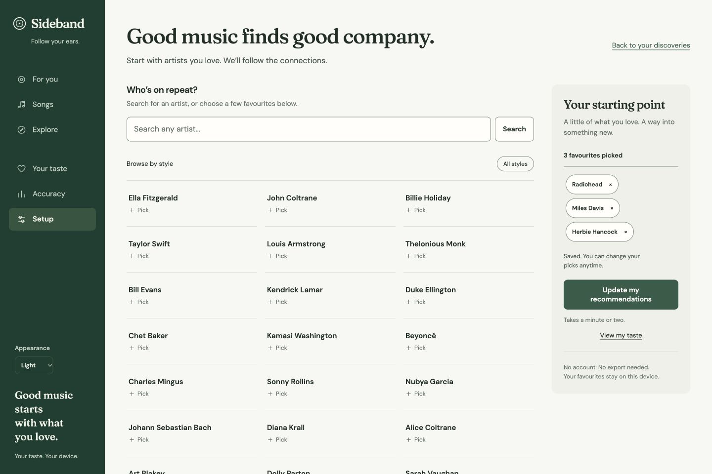

# Sideband

**[Open Sideband](https://sideband.netlify.app/)** · [Use on Mac or iPhone](RUNNING.md#install-the-hosted-app) · [Report a problem](https://github.com/gwilltsherman-byte/sideband/issues/new)

Sideband is my music discovery app. Pick a few artists you love, and every week Sideband deals you ten artists you haven't told it about yet. Choose **Keep**, **Pass**, **Know them** or **Not now** on each one. Nothing you've already seen comes back, and Sideband learns only from what you tell it. No account and no Spotify are needed. Your picks and choices stay on your device; finding new music requires an internet connection.



## Start finding music

1. Search for an artist you love, or pick favourites from the starter choices.
2. Choose **Find my music**. Sideband opens **This week** with your ten.
3. Listen, then choose **Keep**, **Pass**, **Know them** or **Not now** on each artist.

## How your ratings work

**This week** shows about ten unfamiliar artists, chosen from your taste. Most
are close to what you love; one or more are marked **Wildcard**, a little
further out. How many wildcards you get follows the **adventurous** dial; the
dial applies to your next ten and to **5 more**, never to the batch you already
have. An artist shown in an earlier week that you left unanswered can come back
once, marked **Second look**; after that it is not shown again.

- **Keep** means you like the artist. **Pass** means not for you.
- **Know them** means you already know the artist, so they are left out of
  discovery without counting as a like or a dislike.
- **Not now** sets the artist aside for four weeks without rating them.

Each choice moves the artist into **Sorted this week**, with an **Undo** button
that puts the card back where it was. A progress line shows how many you have
sorted. Your batch stays the same for the whole week, including after a reload;
a new ten arrives the following Sunday. When everything is sorted you can choose
**Deal 5 more now**, and a small **5 more** button sits under the list while
cards remain. If there is nothing left near your taste, Sideband says so;
adding more favourites in Setup, or trying Explore, gives it more to work with.

**More songs** on a card lists five songs by that artist, each with a preview
when one is found and a listen link. Choose where listen links open with
**Listen on**: Spotify, Apple Music, YouTube Music, Deezer or Bandcamp. The
choice applies to every listen link in the app.

**Your keepers** lists every artist you have kept, newest first, with a listen
link for each. **Share list** shares the names, or copies them when sharing is
not available. Above it, a plain score sums up how many artists you have been
shown, kept, passed and already knew.

The full ranked list is still available: choose **Browse the full ranked list**
on This week to open **For you**. There you can mark **Like**, **Not for me** or
**Already know them**; **Apply ratings** updates the visible list without moving
you elsewhere. You can undo a rating, and your adventurous setting and list
length survive a reload.

Songs have **Like**, **Dislike**, **Already know** and **Undo** controls too.
Liking a song makes it a seed for related songs. Disliking it removes that song,
including alternate remaster names, and reduces related matches. It does not
reject every song by its artist. Distinct song ratings also contribute bounded
evidence about that artist; an explicit artist preference carries more weight.
**Your taste** keeps saved ratings available so you can change your mind later.

**Play preview** appears after a matching audio clip is found. Songs on screen
are checked automatically; the rest are checked as you scroll. When a clip is
missing, Sideband shows a plain status beside the listen link. A failed
lookup offers **Retry check**, and failed audio offers **Reload preview**.

Sideband also learns weaker interest signals from listening to previews and
opening music links. A preview must actually play for at least ten seconds;
seeking, buffering and failed playback do not count. Repeated signals are
capped and fade with time, and cannot override an explicit dislike. Opening
a listen link records interest in a link, not evidence that you played a song
there. These signals stay on your device and do not become listening-history
plays or inflate the rating-based accuracy results.

## Install on iPhone or Mac

[Open Sideband](https://sideband.netlify.app) in Safari. The hosted app works
with cellular data or any internet connection, so your Mac can be switched off.

1. Open [sideband.netlify.app](https://sideband.netlify.app) in Safari.
2. **iPhone:** tap **Share > Add to Home Screen**, then **Add**.
   If **Open as Web App** appears, leave it on.
3. **Mac with macOS Sonoma 14 or later:** choose **File > Add to Dock**, then **Add**.
4. Open the new Sideband icon before picking favourites or importing history.

Your picks, ratings and listening history stay saved on that device after you
close the app. In **Setup > Backup and restore**, save a backup before changing
devices or clearing app data, and restore it on the other device. Data does not
sync automatically. After the first download, saved data can open offline;
finding new music needs an internet connection and the hosted lookup service.

See the [installation guide](RUNNING.md#install-the-hosted-app) for details.

### Optional local development

The [development guide](RUNNING.md#optional-local-development-on-mac) covers
local servers, home Wi-Fi testing, Codespaces and hosting a copy. These are
optional development setups; normal use of the hosted app does not require
Terminal or a running computer.

## Prediction limits

Predictions depend on the available similarity data and on what you tell Sideband. Mood, context and artists outside that data can affect what you enjoy. Sideband checks its predictions in several ways:

1. It tracks your **Keep** / **Pass** choices (and *Like* / *Not for me* ratings) as a live hit rate, with an error bar. This is the main measure of how well Sideband suits you, and it needs nothing but your choices.
2. If you import a listening history (see [the optional section below](#optional-import-a-listening-history)), it uses plays and skips to distinguish music you heard from music you enjoyed.
3. With a history, it checks proposed personal settings against defaults on **your** history. A change needs enough observed outcomes and a positive paired bootstrap interval on validation; a sparse or inconclusive history retains defaults.
4. With a history, it also tests itself on data it has never seen: it hides your most recent months, predicts from everything before, and reports how many of the artists you actually went on to love it found. Results come with 95% confidence intervals and are compared against baselines.

## Getting started

**Right away:** in Setup, search for any artist and choose **Love** on the matching result, or tap artists you enjoy in the starter choices. Each pick saves that favourite; tap again to remove it. Choose styles to browse a smaller set, or **Show more** to see other artists. Choose **Find my music** when ready; Sideband opens **This week** with your first ten. A few favourites from different parts of your taste give the recommender more to work with, but you can start with one. Browsing a style does not save a preference.

The starter catalog works offline and covers a range of styles and eras. It helps you select familiar artists; live music services supply the similarity data used for recommendations. Selected artists stay in place while you pick, and your saved favourites survive a reload.

**Optional lists and files:** expand the additional input section if you already have names to paste or a playlist CSV/TSV. Review the preview, choose **Use this taste**, then **Find my music**. Repeated input does not increase its weight.

For a song list:

```text
Radiohead — Weird Fishes
Björk — Jóga
Nina Simone — Sinnerman
```

For a playlist table:

```csv
Artist,Track Name
Radiohead,Weird Fishes
Björk,Jóga
Nina Simone,Sinnerman
```

Artist names containing commas belong on their own line, or in quoted CSV fields. A playlist URL or list of Spotify track links is not enough: use music names or a table containing them. The preview shows errors before anything is saved. These are favourites, not measured plays or skips. Your Keep and Pass choices work on them immediately.

You can still search artists individually or use `sideband pick "Artist" "Another artist"`. Marking artists you can't stand (**Not for me**) helps too. A favourite or a new Like overrides older skips of that artist; hiding a single song does not reject the whole artist.

**Data sources:** Deezer, ListenBrainz and MusicBrainz, which need no keys. On a computer, if you have a free [Last.fm API key](https://www.last.fm/api/account/create), set the `LASTFM_API_KEY` environment variable (or run `sideband config --lastfm-key KEY`) to add Last.fm's similarity data too.

## How it works

| Step | What happens | Why |
|---|---|---|
| **1. Implicit feedback** (`taste.py`) | Only if you import a listening history. Each play is scored by the share of the song you heard, whether you chose it (clicked it or went back to it), and whether you skipped it in the first 30 s. The score fades with age (tunable half-life). Liked songs, follows and playlist adds add to it; hidden songs and artists count against. | Implicit-feedback recommender systems ([Hu, Koren & Volinsky 2008](http://yifanhu.net/PUB/cf.pdf)); 30 s is Spotify's own "stream" threshold, and early skips are the clearest dislike signal. |
| **2. Satisfaction** | With a listening history: for each artist, the probability that a play is not an early skip. It is estimated with a Beta prior fitted to your whole history (empirical Bayes). | An artist you heard twice shouldn't be judged as confidently as one you heard 200 times. |
| **3. Similarity graph** (`graph.py`) | Starting from the artists you picked (plus your all-time and recent favourites if you imported a history), sideband crawls similar-artist lists from ListenBrainz, Deezer and, if configured, Last.fm, and merges them into one weighted graph. Edges that several sources agree on count more. Genres come from MusicBrainz (looked up ten artists per request) or Last.fm. | Using several independent sources makes the similarity estimates more robust. |
| **4. Scoring** (`recommender.py`) | Every unfamiliar artist gets 8 interpretable features: item-based CF, recent-taste CF, Personalized PageRank ([Haveliwala 2002](https://doi.org/10.1145/511446.511513)), how many of your artists point to it, TF-IDF genre-profile cosine, popularity, similarity to artists you skip, and source agreement. A linear model combines them. | Every prediction can be explained. That's the bar under each artist in the app. |
| **5. Personal fit** (`evaluation.py`) | A time-based backtest compares memory half-life, seed weighting and walk-restart probability on a *validation* window. Regularised logistic regression fits feature weights only to observed repeated/consistently-skipped artists; unheard artists are not invented dislikes. Changes need sufficient outcomes and a positive paired bootstrap improvement interval; weight fitting also uses withheld validation artists. | Different listeners behave differently. Defaults and stronger regularisation protect small histories from overfitting. |
| **6. Re-ranking** | Maximal Marginal Relevance ([Carbonell & Goldstein 1998](https://doi.org/10.1145/290941.291025)), so a list isn't ten copies of one band. The **adventurous** dial trades predicted accuracy for novelty: less famous artists, further from your genres, a longer random walk. | The backtest reports how many hits you give up at each dial setting. |
| **7. Exploration** (`explore.py`) | Unfamiliar nearby genres are ordered by Thompson sampling, with a heuristic prior from artist affinity. Each shows *gateway artists* connected to what you already enjoy. Latest ratings update the genre votes once per artist; changing or clearing a rating removes its old vote. The heuristic is not a measured chance of liking a genre. | An explore/exploit approach ([Chapelle & Li 2011](https://papers.nips.cc/paper/4321-an-empirical-evaluation-of-thompson-sampling)), whose real-world results still need your ratings. |
| **8. Songs** (`tracks.py`) | Three clearly separated lists: songs that go with your most-loved songs (Last.fm's track-to-track similarity, or Deezer's artist radio without it), the best-known song of each recommended artist, and popular songs by your favourite artists that you've never played. | |
| **9. This week** (`app.py`) | Each week, ten artists you haven't picked, rated or played, taken from the diversified ranking. The adventurous dial sets how many are wildcards, drawn from a more adventurous ranking and spread through the list. An artist left unanswered can return once; after two showings it is retired, and **Not now** sets it aside for four weeks. | A short, fixed batch that you can finish, with no repeats. |

### How accuracy is measured

```
|------------- train ------------|-- validation --|----- test -----|
                                t_val           t_test            now
```

* **Ground truth:** an artist you'd never played counts as *adopted* if you streamed them without skipping at least 3 times on at least 2 different days in the window. It counts as *rejected* if every qualifying play was skipped within 30 s. Neither label is a direct statement of love or dislike.
* **Recall@K / Precision@K / NDCG@K:** of the artists you went on to adopt, how many were in the top K?
* **Mean percentile rank** ([Hu et al. 2008](http://yifanhu.net/PUB/cf.pdf)): where those artists landed in the full ranking. Missing discoveries count as worst rank. The random baseline includes the same coverage penalty.
* **Preference AUC:** among the observed adopted/rejected artists already available in the history-built pool, how often does Sideband rank the adopted one higher? Coverage and class counts appear beside the score. Held-out artists are never looked up to make this test easier.
* Metrics grade the diversified list users actually receive and compare it with *most popular first*, *similar-artists only* and *random*. Recall and AUC have bootstrap 95% intervals. Settings are chosen on validation only; the final test never decides which settings are installed. The public similarity data is current rather than a historical snapshot, and listening logs contain exposure bias. This is a useful check, not an unbiased experiment about future enjoyment.

The percentile shown on an artist card is its position among current candidates. It is **not** a like probability. A separate provisional likelihood estimate only appears after enough distinct, usable Like/Not for me ratings.

### Validation against known ground truth

Real listening logs cannot reveal what someone would have enjoyed but never heard, so the test suite includes a simulator (`synthetic.py`). It builds 8,000 artists in a latent style space, noisy and popularity-biased similarity lists, and a listener whose taste drifts over time. This tests correctness against planted preferences, not real-world accuracy.

On the default simulated listener, the current top 30 safe recommendations average 0.78 true like-probability, about 3.5 times a random unfamiliar artist. At the adventurous setting they average 0.75, with a smaller typical audience. The honest history-only backtest finds about 65% of later adopted artists in its top 50, versus about 13% for random and 0% for popularity on the same pool. Preference AUC is about 0.54 with only six covered rejected artists, so it is uncertain and this example does not justify personal settings.

Older versions reported higher preference AUC after looking up future outcome artists. That procedure changed the graph using the answers being graded. Those figures are no longer used. The tests now verify candidate coverage, absence of future lookups, feedback reversals, and meaningful discovery lift. Run the accuracy test on your own history for results relevant to you.

## Command line

```
sideband serve [--demo] [--phone] [--port 8765] [--no-browser]
sideband pick ARTIST... [--dislike | --remove]   # save favourites (all you need)
sideband import PATH...                 # CSV/TSV/TXT favourites, or optional Spotify ZIP/JSON history
sideband config --lastfm-key KEY [--no-listenbrainz]   # optional; or set LASTFM_API_KEY
sideband profile
sideband recommend [-n 30] [--explore 0.3]
sideband songs
sideband explore [--tag "bossa nova"]
sideband evaluate [--json]
```

Data is stored in the `~/.musicfinder/` folder (`musicfinder.db` with settings and ratings, `musicfinder-data.db` with your listening history, `musicfinder-cache.db` with cached lookups). To use a different folder, pass `--home DIR` or set `MUSICFINDER_HOME`.

## Optional: import a listening history

Sideband doesn't need any listening history: your favourites and your Keep and Pass choices are all it needs. If you already have a Spotify listening history, you can add it in **Setup** under **Optional extra: import a Spotify listening history**. It adds skips, how your taste has changed over time, and the replay accuracy test, which replays your history to measure how well Sideband predicts *you*. Without it, your Keep and Pass choices measure accuracy.

1. Go to **Spotify → Account → [Privacy settings](https://www.spotify.com/account/privacy/)**.
2. Tick **Extended streaming history** and request it. This export lists every play since you joined, including how long you listened and whether you skipped. Spotify can take a few days, and up to 30, to send it.
   *Account data* is faster (about 5 days) and also works, but it only covers the last year and has no skip flags. You can import both.
3. Drop the `.zip` Spotify emails you into the app (Setup tab), or run `sideband import my_spotify_data.zip`.

Choose **Improve from my history** after importing: eligible new history is tested once, and importing the same files does not trigger another build. The recommendation page shows which history is in use and whether its settings have been tested.

### Why not just log in with Spotify?
Spotify no longer gives new third-party apps its recommendation, related-artist or audio-feature endpoints ([Nov 2024](https://developer.spotify.com/blog/2024-11-27-changes-to-the-web-api)). Since [February 2026](https://developer.spotify.com/documentation/web-api/tutorials/february-2026-migration-guide), development-mode apps also require a Premium owner and are capped at five users. Spotify's [Developer Policy](https://developer.spotify.com/policy) also forbids feeding data from its API into machine-learning models, which is what sideband's ranking is. Your data export is different: it's your own data, sent to you. It's also more informative: the API exposes your last 50 plays, while the export has your whole history *with skips*.

## Privacy

Everything runs on your computer. Your picks and listening history stay in the local SQLite database and are never uploaded. The only things sent out are artist and song names, which go to Deezer, ListenBrainz, MusicBrainz and (if configured) Last.fm to look up similarity, genres and previews. Responses are cached locally for 30 days. The web server listens on 127.0.0.1 only, refuses requests whose Host header isn't local, and requires a custom header on any request that changes data. With `--phone` it also listens on your home network, and any device other than the computer must present the secret key from the printed link.

In the browser version, everything runs in your browser, and your picks and history are stored in that browser's storage on your device. Artist and song names pass through your site's relay function on their way to the music services; if you set `LASTFM_API_KEY`, the relay adds it there, so the key never leaves the lookup server. The relay stores nothing. It only forwards GET requests to those services' specific API addresses, and browsers won't let other websites' pages use it. (A program outside a browser could still use it for those same public addresses.)

## Development

```
pip install -e '.[dev]'
pytest                     # ~80 s; includes the simulated-listener validation and fake-API runs
npm install && npm run build && npm run test:js   # hosted build and its relay function
MUSICFINDER_E2E=1 pytest tests/test_site.py      # ~12 min: the hosted site in an emulated phone (Playwright)
```

The engine is pure Python standard library. numpy is used only if it's installed, and only to speed up building the demo world. The hosted build adds Pyodide (an npm dependency) and plain JavaScript; there is no front-end build step.

`tests/fake_upstream.py` imitates Last.fm, Deezer, MusicBrainz and ListenBrainz using the simulated world. Tests use it to exercise the real API clients, and to check that the browser's parallel prefetch plan covers every request (`tests/test_live_path.py`).

