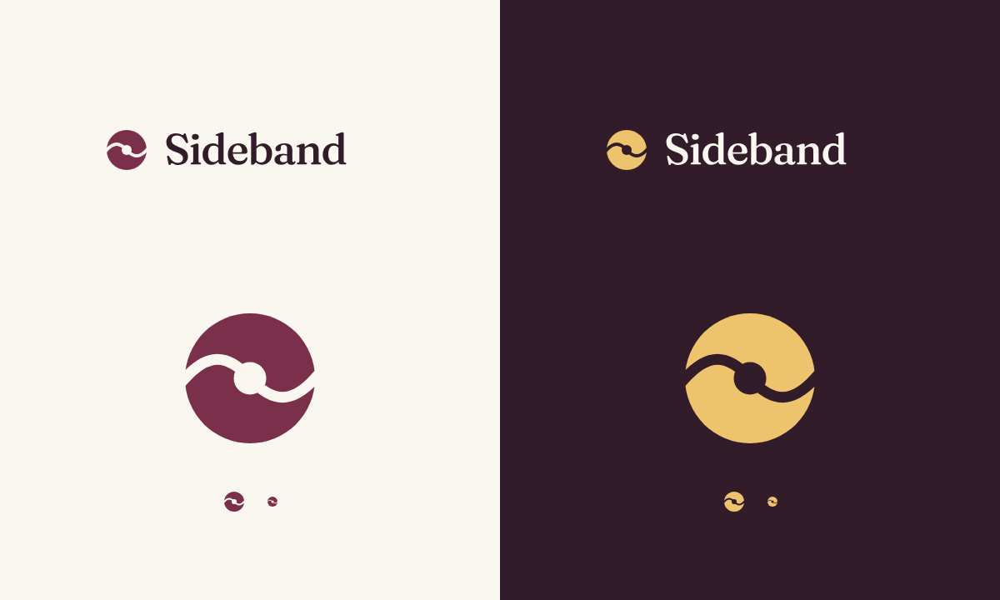

# Sideband logo assets

The mark is a plain record: a white disc with a hot-pink label, on an aubergine ground for icons. It stands for the music you already love, Sideband's starting point, and is kept simple so it reads at any size. The lettering keeps the app’s existing Fraunces identity. The icon ground was updated to match the user-supplied white-and-pink record reference; the reference's embedded color profile resolves to white `#ffffff`, pink `#ff3d7f`, and aubergine `#331c2a` in sRGB.

## Files

- `../../musicfinder/web/brand-mark.svg`: white-and-pink record used in the application header.
- `sideband-light.svg`: transparent coral record and ink lockup for light backgrounds.
- `sideband-dark.svg`: transparent white record and ivory lockup for dark backgrounds.
- `app-icon.svg`: full-bleed icon master, with mask-safe placement.
- `../../musicfinder/web/favicon.svg`: optically enlarged favicon.
- `../../musicfinder/web/icon-{180,192,512}.png`: installed app icons.

SVG lockups contain outlined Fraunces Medium lettering, so they render without a font download. Keep the existing font license in `../../musicfinder/web/fraunces-OFL.txt` with any redistributed font files. The original vector geometry and outlined lettering were authored locally; PNGs are raster exports, not stock or generated imagery. Their provenance is embedded in the PNG metadata.

For icon updates, render `app-icon.svg` to the three exact PNG dimensions with an SVG renderer (the current exports use Sharp/librsvg). Keep the opaque ground and preserve the proportions. Re-embed image provenance after replacing any PNG. Rebuild the site to update its content hash and offline cache. Hosted Apple touch, manifest, and manifest icon URLs include that version; the local app also exposes the Apple touch icon.

See `../../DESIGN.md` for color, spacing, sizing, and interaction rules.

## Icon reference update

- Exported opaque 180/192/512px PNGs from the updated vector, preserving the mask-safe geometry and embedded provenance.
- Confirmed background and spindle pixels are `#331c2a`, label pixels `#ff3d7f`, and disc pixels `#ffffff`, matching the reference after its color profile is converted to sRGB.
- Inspected the 180px export visually. The hosted build test passes, including one versioned Apple touch link, versioned manifest icon URLs, exact PNG dimensions, successful image delivery, and offline precache coverage.
- Existing installed iOS shortcuts may retain their previous icon until removed and added again. Actual iPhone installation and automatic refresh were not tested.

## Verification

- Browser review in Chromium: 1440×1000 desktop and 390×844 phone, light and dark. The mark sits in the existing 32px header box with no layout change; no overflow or collision with Appearance.
- The original colorway exploration used a coral icon ground. The supplied reference supersedes that choice for app icons and the favicon: white disc, pink label, aubergine ground. Coral remains in the light wordmark lockup.
- The favicon and emblem are still served as SVG with `nosniff` and included in the generated site and offline precache (covered by `tests/js/build.test.mjs`).
- All 48 JavaScript tests passed and the production build succeeded.
- All app-icon PNGs have the exact target dimensions and opaque backgrounds. At 512px the white disc has a 153.6px radius, inside the 204.8px maskable safe radius.
- The interface palette is unchanged; coral and pink are used only in the logo.
- No animation was introduced. Real device installation and automatic OS icon refresh were not tested.

[Desktop app](../screenshots/overview.jpg) · [Mobile, light](mobile.jpg) · [Mobile, dark](mobile-dark.jpg)

